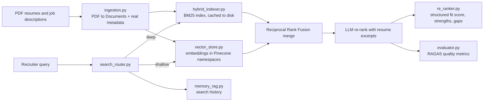

# HireFlow

**AI-powered candidate search and evaluation.** HireFlow is a modular RAG
(Retrieval-Augmented Generation) pipeline that reads resumes and job
descriptions from PDF files, indexes them for keyword *and* semantic search,
finds the best-matching candidates for a query, lets an LLM judge each
candidate's fit, and measures the quality of the whole thing with RAGAS. A
Streamlit web app puts all of this behind a picture-and-card UI, with search,
a browsable talent pool, and AI evaluation explained in plain language.

**Tech stack:** Python · LangChain · Google Gemini (LLM + embeddings) ·
Pinecone (vector DB) · BM25 (`rank-bm25`) · RAGAS · Pydantic · Streamlit

---

## Table of contents

1. [How it works](#how-it-works)
2. [Project structure](#project-structure)
3. [Module reference](#module-reference)
4. [The Streamlit app](#the-streamlit-app)
5. [End-to-end data flow](#end-to-end-data-flow)
6. [Setup](#setup)
7. [Running the project](#running-the-project)
8. [Sample data](#sample-data)
9. [Design notes](#design-notes)
10. [Extending HireFlow](#extending-hireflow)

---

## How it works



Two search strategies are available, chosen by the router:

| Mode | What it does | When it is used |
|------|--------------|-----------------|
| **shallow** | Vector (semantic) search only. One embedding call, one Pinecone query. | Short / simple queries such as `"accountant"` |
| **deep** | BM25 keyword search **+** vector search, merged with Reciprocal Rank Fusion, then reordered by the LLM (which sees a resume excerpt, not just a score). | Detailed queries such as `"senior accountant with QuickBooks and tax experience"` |
| **auto** *(default)* | The LLM classifies the query **once** per search; if unavailable, queries of ≤ 3 words go shallow, longer ones deep. | Everyday use |

If Pinecone isn't configured, the app doesn't stop working — it falls back to
keyword-only (BM25) search and tells you so.

---

## Project structure

```
HireFlow/
├── main.py                  # CLI demo: wires every module together and runs demos
├── requirements.txt         # Python dependencies
├── README.md                # This file
│
├── core/                    # The pipeline (one module per stage)
│   ├── __init__.py          # Package marker + module overview
│   ├── ingestion.py         # 1. PDF files -> LangChain Documents + real metadata
│   ├── parsing.py           # 2. LLM structured extraction (ResumeParser, JobParser)
│   ├── vector_store.py      # 3. Pinecone: embeddings, upsert, semantic search
│   ├── hybrid_indexer.py    # 4. BM25 + vector search, merged with RRF
│   ├── search_router.py     # 5. Shallow vs deep routing, LLM re-ranking
│   ├── re_ranker.py         # 6. LLM candidate-vs-job evaluation (structured fit score)
│   ├── evaluator.py         # 7. RAGAS search-quality metrics
│   └── memory_rag.py        # 8. Session search history
│
├── data/
│   ├── resumes/             # 50 sample resume PDFs
│   ├── jds/                 # 18 sample job description PDFs (Entry to Leadership)
│   └── bm25_index.json      # generated on first run - local BM25 text cache (see below)
│
├── utils/                   # (imported by the code - see note below)
│   ├── config.py            # API keys / model / index settings (reads .env)
│   ├── schemas.py           # Pydantic models: Resume, JobDescription, CandidateEvaluation
│   └── utils.py             # load_pdf, split_text, clean_text, truncate_text,
│                            # get_embeddings, get_rate_limiter, is_quota_error, get_logger
│
└── streamlit/
    ├── app.py               # Web app: search, talent pool, uploads, AI evaluation
    └── ui_helpers.py         # PDF parsing for display, avatars/logos (generated SVG),
                              # HTML card builders, CSS, an offline BM25-only search path
```

> **Note:** `utils/` is imported/referenced by the code but was **not part of
> the archive this README was written from**. Its description above is
> inferred from how the code uses it. A `.env` file (not committed) is also
> required — see [Setup](#setup).

---

## Module reference

### `main.py` — orchestrator and CLI demo
Class `HireFlowDemo` creates every component in dependency order and runs the
demonstrations.

| Method | Purpose |
|--------|---------|
| `check_prerequisites()` | Verifies API keys and that `data/resumes` / `data/jds` contain PDFs |
| `initialize_system()` | Builds `VectorStore → HybridIndexer → SearchRouter → ReRanker/Parsers → RAGEvaluator → MemoryRAG` |
| `load_and_index_documents()` | PDFs → Documents → BM25 + Pinecone indexes (each document embedded exactly once) |
| `test_search_modes()` | Compares vector, hybrid and router-deep search for one query |
| `test_ai_evaluation()` | Parses the job description and asks the LLM to evaluate the top candidate |
| `test_quality_metrics()` | Runs a RAGAS evaluation (slow on free API tiers; now logs a cost estimate first) |
| `test_memory_system()` / `check_system_status()` | Shows session history and index diagnostics |
| `interactive_menu()` | 7-option menu to re-run any demo or re-index |

### `core/ingestion.py` — load PDFs
`load_resumes(dir)` and `load_job_descriptions(dir)` read every `.pdf` and return
one LangChain `Document` per file.
- Resume metadata: `source`, `filename`, `candidate_id` (`c_<file stem>`), `name`,
  and **real** `skills`, `location`, `experience` — extracted with `_extract_resume_facts()`
  (regex over the `Location:` line, years mentioned, and the TECHNICAL SKILLS /
  SOFTWARE PROFICIENCY sections). No LLM call.
- Job metadata: `source`, `filename`, `jd_id` (`jd_<file stem>`), `title`.
- `DocumentProcessor` is a legacy chunking helper kept for compatibility.

### `core/parsing.py` — LLM structured extraction
`ResumeParser.parse_resume(text, candidate_id)` and
`JobParser.parse_job_description(text, jd_id)` run a LangChain chain
`prompt | Gemini | PydanticOutputParser` on the first 8000 characters and return a dict.
`ResumeParser` targets a narrow `_ResumeExtraction` model (name, skills, experience,
education, optional email/phone) — the LLM is never asked to echo the resume text back
or invent a `candidate_id`, and a malformed email no longer fails the whole parse.
One LLM request per document.

### `core/vector_store.py` — semantic search (Pinecone)
Class `VectorStore` manages the Pinecone index and the Google embedding model.
- `initialize()` connects and creates the index if needed. A dimension mismatch no
  longer deletes the index automatically — it refuses and logs what to do, unless you
  explicitly pass `allow_destructive_recreate=True`.
- `add_resumes()` / `add_job_descriptions()` batch-embed the whole list in **one**
  embedding call, then upsert into separate `resumes` / `job_descriptions` namespaces.
  Vector ids are `resume_<candidate_id>` / `jd_<jd_id>` — stable regardless of list
  order, so re-indexing overwrites instead of duplicating.
- `search_resumes()` / `search_job_descriptions()` embed the query with `embed_query()`
  and search within the matching namespace, so a resume search can never return a job
  posting.
- `convert_filters_to_pinecone()` translates simple filters
  (`{"experience": {"min": 3}}`) to Pinecone syntax (`$gte`, `$in`, `$eq` ...).
- `get_stats()` reports vector count, dimension and metric.

### `core/hybrid_indexer.py` — BM25 + vector search
Class `HybridIndexer` keeps an in-memory **BM25** index next to the vector store.
- `index_resumes()` / `index_job_descriptions()` **merge** new documents into whatever
  was already indexed (by `candidate_id` / `jd_id`) instead of replacing it, so indexing
  one new resume no longer erases every resume indexed before it. A shared `_tokenize()`
  (strips punctuation, drops stopwords) is used at both index and query time.
- `search_resumes(query, top_k, filters=None)` runs BM25 and vector search, merges them
  with **Reciprocal Rank Fusion** (`combine_results()` — rank position, not raw score,
  so an unbounded BM25 score can't drown out a 0–1 cosine score), and applies an
  optional hard `filters` dict (e.g. `{"skills": ["QuickBooks"]}`) on a pool larger than
  `top_k` before truncating, so filtering never starves the result list.
- Results carry each candidate's **real** skills/location/experience (read from the
  indexed `Document`'s metadata), not a guess from the first line of text.
- `get_index_stats()` returns readiness flags.

### `core/search_router.py` — routing and LLM re-ranking
Class `SearchRouter` is the single entry point for searches: `search(query, top_k, filters, search_mode, jd_context)`.
- Built on LangChain `RunnableLambda | RunnableBranch`: the route is decided **once**
  per search (not once per branch condition checked), halving the LLM calls routing
  used to cost.
- `deep_search` passes `filters` through to `HybridIndexer.search_resumes()`.
- `llm_rerank()` gives the LLM each candidate's real skills/experience/location **plus
  a short resume excerpt**, and asks for a new order; the answer is accepted only if it
  contains exactly one number per candidate.
- Falls back shallow ⇄ deep once if a strategy fails.

Returns `{"results": [...], "search_type": ..., "query": ..., "top_k": ...}`.

### `core/re_ranker.py` — candidate evaluation
Class `ReRanker` compares a `Resume` with a `JobDescription`.
- `evaluate_candidate()` asks Gemini for a **structured** JSON assessment
  (`_FitAssessment`: `fit_score` 0–100, strengths, gaps, risks, summary) via
  `PydanticOutputParser`, so the score reflects the model's actual judgment instead of
  a formula counting bullet points, and "gaps" is a real section the model fills in.
- `simple_evaluation()` is the rule-based fallback (skills / years of experience) used
  when no LLM is available.
- `re_rank_candidates()` evaluates a list and sorts it by `fit_score`.

### `core/evaluator.py` — RAGAS quality evaluation
Class `RAGEvaluator` runs a search and scores it with four RAGAS metrics:

| Metric | Weight in `overall_score` |
|--------|---------------------------|
| answer_relevancy | 30 % |
| context_precision | 30 % |
| faithfulness | 20 % |
| answer_correctness | 20 % |

- RAGAS now judges a **real** AI output: `ReRanker.evaluate_candidate()`'s assessment
  (the "answer") against the candidate's actual resume text (the "context") — not a
  hand-written template sentence checked against near-empty metadata.
- `estimate_cost(top_k)` returns the expected LLM call count and runtime **before**
  running, and a warning is logged with that estimate at the start of every evaluation.
- Every result carries `judge_failed: bool` — `True` when RAGAS couldn't score at least
  one metric at all (quota/timeout/bad JSON), so a `0.0` is never mistaken for "the
  search is bad" when it actually means "we don't know."
- Also keeps `evaluation_history`, offers `get_evaluation_summary()` and
  `export_evaluations(filename)` (CSV). Gemini acts as the RAGAS judge.

### `core/memory_rag.py` — session memory
Class `MemoryRAG` logs searches and candidate views as a plain list of
`HumanMessage`/`AIMessage` objects (no deprecated LangChain memory classes).
`get_search_history()` returns the last 5 queries; `get_memory_stats()` returns counters.
Memory is in RAM only and is not fed back into search.

---

## The Streamlit app

`streamlit run streamlit/app.py` opens a picture-and-card web UI built on top of the
same `core/` pipeline.

- **Search** — pick a job from the `data/jds` dropdown (or upload a job description PDF)
  to auto-fill the title/description/skills fields, or write your own. Results render as
  cards with a generated avatar, real skills/location/experience, a relevance bar, and a
  matched-skills bar. An expander per candidate holds the full profile, work-history
  timeline, resume download, and AI evaluation tab (top 3 only). An in-app "How
  candidates are selected and scored" panel explains RRF merging and the AI score in
  plain language.
- **Talent pool** — browse, filter (role/level/location/keyword) and chart the whole
  candidate pool, each with a generated profile picture.
- **Uploads** — adding a resume updates **both** indexes: the local BM25 cache
  immediately (free), and Pinecone exactly once per resume (never repeated on a later
  restart — see `bm25_index.json` below).
- **Memory & evaluation page** — session search history, and a RAGAS run with its
  estimated cost shown before you start it.
- **Search debug trace** — an optional checkbox on the search form ("Show step-by-step
  search trace") that reveals exactly what happened: the BM25 matches and scores, the
  vector/Pinecone matches and similarity scores, the Reciprocal Rank Fusion merge table,
  the effect of the required-skills filter, and - if an LLM is configured - the exact
  resume excerpts sent to Gemini for re-ranking, its raw reply, and whether that reply
  was accepted or rejected. Turning this on routes the search through `SearchRouter` in
  "deep" mode (instead of calling `HybridIndexer` directly), so the AI re-rank step
  genuinely runs rather than being simulated for display - this costs one extra LLM call,
  only when checked.

`streamlit/ui_helpers.py` supplies this layer: rule-based PDF parsing for display
(separate from `core/ingestion.py`'s metadata extraction, since the UI wants more
detail — contact info, education, work-history bullets), generated SVG avatars/company
logos/hero art (no external images or API calls), the HTML/CSS for all of the above, and
an offline, BM25-only `LocalSearch` fallback.

### BM25 persistence (`data/bm25_index.json`)
Re-reading and re-tokenizing every PDF on every restart doesn't scale, so the extracted
resume text is cached to this JSON file. On startup, the app rebuilds BM25 from the
cache (instant) instead of re-scanning `data/resumes`; the cache is only written to
when a resume is uploaded through the app, or via the sidebar's one-time "index
existing resumes" action.

---

## End-to-end data flow

1. **Ingest** – `load_resumes()` turns each PDF into a `Document` with real metadata
   (skills, location, experience).
2. **Index** – `HybridIndexer.index_resumes()` merges into the BM25 index (cached to
   disk via the Streamlit app) and `VectorStore.add_resumes()` embeds and upserts each
   resume into Pinecone exactly once.
3. **Search** – `SearchRouter.search()` picks shallow or deep:
   - *shallow*: embed query → Pinecone → top-k.
   - *deep*: BM25 scores + Pinecone matches → Reciprocal Rank Fusion → LLM re-rank
     (with a resume excerpt).
4. **Evaluate** – `ReRanker.evaluate_candidate()` reads the real resume and job
   description and returns a structured fit assessment.
5. **Measure** – `RAGEvaluator` scores that real assessment against the real resume
   text with RAGAS.
6. **Remember** – `MemoryRAG.record_search()` logs the query once, with the real result
   count.

---

## Setup

**Requirements:** Python 3.10+ (developed with 3.13), a Google Gemini API key and a Pinecone API key.

```bash
# 1. Install dependencies
pip install -r requirements.txt

# 2. Create a .env file in the project root
GOOGLE_API_KEY=your-gemini-key
PINECONE_API_KEY=your-pinecone-key
# Optional overrides (defaults are defined in utils/config.py):
# PINECONE_INDEX_NAME=...
# LLM_MODEL=...
```

`main.py` checks for `GOOGLE_API_KEY` and `PINECONE_API_KEY` at start-up and exits with a
clear message if either is missing. The Streamlit app instead degrades to keyword-only
(BM25) search if Pinecone isn't reachable, and tells you so in the UI.

**Free-tier limits:** the code shares one rate limiter (about 5 LLM requests per minute).
LLM parsing, re-ranking and especially RAGAS evaluation can therefore take a while —
`RAGEvaluator.estimate_cost()` tells you roughly how long before you run one.

---

## Running the project

```bash
# Command-line demo (checks setup, indexes data, runs demos, opens a menu)
python main.py

# Web interface
streamlit run streamlit/app.py
```

What `python main.py` does: prerequisite check → initialise components → index all PDFs →
automatic demos (search modes, AI evaluation, memory, diagnostics) → interactive menu.

---

## Sample data

| Folder | Contents |
|--------|----------|
| `data/resumes/` | 50 synthetic resumes named `First_Last_Resume_NN.pdf`. Each has contact info with a `Location:` line, a professional summary, a `TECHNICAL SKILLS` section, software proficiency, and experience. |
| `data/jds/` | 18 job description PDFs spanning Entry (Junior Accountant, Accounting Assistant) through Mid (Staff/Tax Accountant, Financial Analyst) through Senior (Manufacturing/Audit Senior Accountant, Tax Manager) to Leadership (Controller, VP of Tax). |

Drop your own PDFs into these folders (lowercase `.pdf` extension) to search your own data.
New resumes are picked up the next time you use the Streamlit app's upload button, or
by re-running `main.py`'s indexing step.

---

## Design notes

A few choices worth knowing about if you're extending this code:

| Area | How it works now | Why |
|------|-------------------|-----|
| Hybrid merge | Reciprocal Rank Fusion (`1/(60+rank)` per engine, summed) | BM25's unbounded scores and Pinecone's 0–1 cosine scores aren't comparable directly; rank position is. |
| Resume metadata | Regex-based (`_extract_resume_facts`), not an LLM call | Every sample resume follows a fixed template, so this is free and instant; `ResumeParser` (LLM-based) is available for messier real-world resumes. |
| Pinecone writes | Only on an explicit action (upload button, or the one-time "index existing resumes" button) | Embedding costs money and hits a 5 req/min free-tier limit; nothing should re-embed silently on every app restart. |
| BM25 | Rebuilt from a local JSON text cache on startup, not re-read from PDFs | PDF parsing is the slow part; the cache makes restarts instant without ever touching Pinecone. |
| AI fit score | Structured LLM output (`PydanticOutputParser`), not a formula | A formula based on bullet-point counts can't actually differentiate candidates; asking the model for the number directly can. |
| RAGAS evaluation | Judges `ReRanker`'s real output against the real resume text | Judging a hand-written template against itself doesn't measure anything. |
| Vector namespaces | Resumes and job descriptions live in separate Pinecone namespaces | So a resume search can never return a job posting, even without a metadata filter. |

---

## Extending HireFlow

- **Add a data source:** create a loader in `core/ingestion.py` that returns `Document`s with `candidate_id`/`name` metadata.
- **Change the search strategy:** edit `deep_search` / `route_search` in `core/search_router.py`.
- **Change scoring:** adjust `combine_results()` in `core/hybrid_indexer.py` (e.g. tune the RRF constant, or add a third signal).
- **Add a new evaluation metric:** append it to `ragas_metrics` in `RAGEvaluator.__init__` and to `calculate_overall_score()`.
- **Use another LLM / vector DB:** the LLM client is created in `parsing.py`, `search_router.py`, `re_ranker.py` and `evaluator.py`; the vector DB is isolated in `vector_store.py`.
- **Change the UI:** `streamlit/ui_helpers.py` holds the card/avatar/CSS building blocks; `streamlit/app.py` wires them to the `core/` pipeline.
